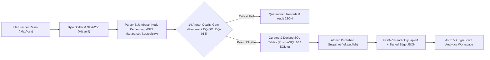

# Kaltim Data Trust

**Public Data Quality, Region-Code Standardization & Regional Health Intelligence Platform (East Kalimantan)**

> **Independent Portfolio Proof-of-Concept:** Proyek ini adalah riset rekayasa data dan analitik sektor publik independen oleh [Fariz Fahrian](https://farizfahrian.com) — **bukan** produk resmi, afiliasi, maupun sistem operasional Pemerintah Provinsi atau Dinas Komunikasi dan Informatika Provinsi Kalimantan Timur.

---

## Mengapa Proyek Ini Dibangun

Mengubah kumpulan spreadsheet pemerintah menjadi dashboard regional tidak boleh dimulai dari komponen grafik. Audit byte-level terhadap file asli Dinas Kesehatan pada katalog **Satu Data Kalimantan Timur** (`data.kaltimprov.go.id`, diakses 18 November 2026) membuktikan enam masalah kualitas data nyata yang dapat menyesatkan pengambil keputusan apabila langsung divisualisasikan:

| # | Temuan Audit Nyata | Bukti Sumber (`SHA-256`) | Penanganan di `Kaltim Data Trust` |
|---|---|---|---|
| 1 | **File `.csv` berisi kontainer biner `.xlsx`** | `SRC-DOC` (`1 TENAGA DOKTER.csv` → `f427719f4407…`, magic `PK\x03\x04`) | `sniff.py` mendeteksi signature byte ZIP/XLSX, mencatat peringatan `DQ-001`, dan menyalurkan `io.BytesIO` ke parser `openpyxl`. |
| 2 | **Benturan kode wilayah Kemendagri vs BPS tanpa label** | `SRC-PKM-RI` (`f927d320…`) & `SRC-PKM-NRI` (`c6f54da0…`) memakai `6402=Kutai Barat`, sedangkan `SRC-DOC` memakai `6402=Kutai Kartanegara` | `region_aliases.csv` & `RegionResolver` memetakan kode BPS/Kemendagri secara eksplisit dengan validasi silang nama wilayah (mencegah tertukarnya data 4 kabupaten). |
| 3 | **Salah ketik kode wilayah duplikat** | `SRC-DOC` baris `R65` memberi Kota Bontang kode `6472.0` (milik Kota Samarinda) | Diselesaikan lewat kebijakan otoritas nama wilayah terverifikasi dan dicatat transparan pada hasil audit `DQ-003`. |
| 4 | **Korupsi serial waktu Excel & pemisah ribuan** | `SRC-DOC-RATIO-BAD` (`aa5b1aee…`): rasio Paser `45,05` terbaca `1,877083` hari; penduduk `286.991` menjadi float `286.990999` | **Dikarantina penuh (`QUARANTINED`)** oleh `DQ-005` & `DQ-009` sehingga gagal masuk ke *Published Snapshot*. |
| 5 | **Subkategori melampaui nilai total pada tahun historis** | `SRC-DOC` tahun 2022: Berau (`Dokter=185 < Dokter Umum=197`), Kubar (`120 < 184`) | `DQ-007` memblokir seri 2022 secara otomatis sementara meloloskan seri terverifikasi 2023–2025. |
| 6 | **Selisih rekonsiliasi agregat provinsi** | `SRC-DOC` Dokter Spesialis 2024: jumlah 10 kab/kota `930` vs baris provinsi `980` (`+50`) | `DQ-011` tidak mengubah angka sumber secara diam-diam, melainkan memberi status `warning` pada observasi provinsi. |

---

## Arsitektur Sistem



Setiap indikator yang tampil di antarmuka memenuhi invarian keras:
> **Tidak ada angka yang ditampilkan tanpa sumber, satuan, wilayah kanonik, tahun referensi, rumus transformasi, status validasi, dan jejak sel asalnya (`sheet!R..C..`).**

---

## Struktur Repositori

```text
kaltim-data-trust/
├── docs/
│   ├── prd.md                                    # Spesifikasi kebutuhan produk (PRD v1.0)
│   ├── data-source-audit.md                      # Bukti audit byte, hash, & rekonsiliasi 10 kab/kota
│   ├── data-dictionary.md                        # Kamus tabel, jembatan kode wilayah, & semantik NULL
│   ├── metric-feasibility.md                     # Keputusan GO/NO-GO per indikator
│   ├── methodology.md                            # Alur 10 tahap deterministik & rumus rasio
│   ├── limitations.md                            # Batas kesimpulan domain & kebijakan lisensi
│   ├── portfolio-case-study.md                   # Ringkasan studi kasus rekayasa
│   └── decisions/                                # Architecture Decision Records (ADR-001, ADR-002)
├── data/
│   ├── manifests/sources.yml                     # Registri sumber dengan SHA-256 & sistem kode
│   ├── mapping/{region_aliases.csv,metric_map.yml}
│   ├── fixtures/synthetic/                       # Fixture sintetis berlabel jelas untuk pengujian
│   └── raw/.gitkeep                              # File mentah eksternal sengaja di-gitignore
├── sql/
│   ├── schema_postgres.sql                       # DDL PostgreSQL 16+ & partial unique index snapshot
│   └── analytical_queries.sql                    # Kueri pelacakan lineage & rekonsiliasi provinsi
├── pipeline/                                     # Paket Python `kdt` (CLI, ETL, DQ, SQL, FastAPI)
│   ├── src/kdt/
│   └── tests/test_kdt_suite.py                   # 20 skenario uji kritis (T-001 s/d T-020)
├── api/app/main.py                               # Entry point server FastAPI
├── web/                                          # Aplikasi web Astro 5 + TypeScript (Cloudflare ready)
└── artifacts/quality/                            # Laporan JSON hasil pemeriksaan kualitas per run
```

---

## Cara Menjalankan & Mereproduksi

### 1. Menjalankan Test Suite Kualitas Data & Kontrak API (`T-001`..`T-020`)
Tidak memerlukan unduhan eksternal — menggunakan fixture deterministik terisolasi:

```bash
cd pipeline
uv sync --extra dev --extra postgres
uv run ruff check src tests
uv run pytest -v
```

### 2. Menjalankan CLI Pipeline (`kdt`)
```bash
cd pipeline
# Inspeksi signature byte & SHA-256
uv run kdt audit --source SRC-DOC --file ../data/fixtures/synthetic/syn_doctors_2024.csv

# Simulasi validasi tanpa mempublikasikan snapshot (--dry-run)
uv run kdt ingest --source SRC-DOC --file ../data/raw/src-doc_0_1-dokter.xlsx --dry-run

# End-to-end build dari file sumber lokal terverifikasi -> SQL -> Snapshot JSON
uv run kdt build-official
```

### 3. Menjalankan Antarmuka Web Analitik (Astro 5)
```bash
cd web
npm install
npm run check
npm run dev      # Buka http://localhost:4321
```

### 4. Menjalankan Stack Penuh dengan PostgreSQL 16 (`Docker Compose`)
```bash
docker compose up --build
# PostgreSQL 16 : localhost:5432
# FastAPI OpenAPI: http://localhost:8000/docs
# Astro Web UI  : http://localhost:4321
```

---

## Kebijakan Lisensi & Data Publik

- **Kode sumber proyek:** Dilisensikan di bawah [MIT License](./LICENSE).
- **Data statistik pihak ketiga:** Tetap menjadi hak dan tanggung jawab penerbit resmi (**Dinas Kesehatan Provinsi Kalimantan Timur** melalui portal **Satu Data Kalimantan Timur**). Karena metadata katalog CKAN belum mencantumkan pengenal lisensi terbuka formal (`No License Provided`), repositori ini **tidak meng-host ulang file `.xlsx`/`.csv` mentah** dan selalu menautkan pembaca ke halaman resmi penerbit.
