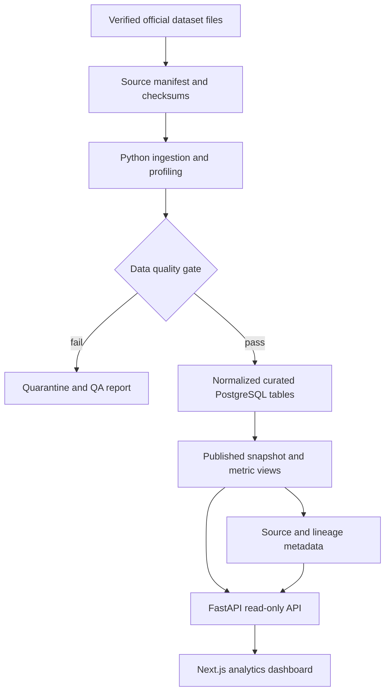

# Product Requirements Document (PRD)

# Kaltim Data Trust
### Public Data Quality & Regional Health Intelligence Platform

> **Versi:** 1.0 — Execution-ready specification  
> **Tanggal penyusunan:** 18 November 2026  
> **Status:** Siap dieksekusi setelah *data discovery gate*  
> **Pemilik produk:** Independent / personal portfolio project  
> **Domain MVP:** Distribusi fasilitas kesehatan dan tenaga dokter di Kalimantan Timur  
> **Target utama:** Membuktikan kemampuan data management, data integration, data quality, SQL, analytics, visualization, serta data lineage untuk kebutuhan pengambilan keputusan  
> **Bahasa antarmuka:** Bahasa Indonesia; identifier dan dokumentasi teknis dapat menggunakan bahasa Inggris  
> **Catatan independensi:** Proyek ini **bukan** produk resmi, kerja sama, atau sistem operasional Diskominfo/Pemprov Kalimantan Timur.

---

## Cara menggunakan dokumen ini

PRD ini adalah *source of truth* untuk implementasi. Eksekusi dimulai dari **Section 4: Data Discovery Gate**, bukan dari pembuatan desain UI. Semua contoh payload dan kolom dalam dokumen merupakan **kontrak desain target**, bukan klaim bahwa kolom tersebut telah diverifikasi pada file sumber.

**Konvensi prioritas:**

- **P0 / Must have:** Wajib agar MVP layak disebut selesai.
- **P1 / Should have:** Nilai tambah bermakna setelah MVP terverifikasi.
- **P2 / Later:** Pengembangan lanjutan, jangan menghambat MVP.
- **BLOCKER:** Tidak boleh dilewati; keputusan memerlukan bukti.
- **DOD:** Definition of Done / kriteria sebuah pekerjaan selesai.

**Prinsip keras:** *Never display an indicator without its source, unit, geography, period, transformation rule, and validation status.*

---

# 1. Executive Summary

## 1.1 Ringkasan produk

**Kaltim Data Trust** adalah aplikasi web analitik untuk mengubah dataset publik pemerintahan yang terpisah-pisah menjadi indikator regional yang dapat ditelusuri dan diverifikasi. Versi pertama berfokus pada layanan kesehatan Kalimantan Timur: jumlah fasilitas kesehatan, distribusi dokter, dan, jika valid, normalisasi per jumlah penduduk.

Produk memiliki dua pengalaman yang saling terkait:

1. **Data Trust Workspace:** memeriksa sumber, menjalankan import, melihat validasi, mengetahui record bermasalah, dan memeriksa asal-usul indikator.
2. **Regional Intelligence Dashboard:** membandingkan indikator yang lolos validasi antar kabupaten/kota, membuka detail wilayah, membaca definisi metrik, dan melihat catatan interpretasi.

Perbedaan utama dari dashboard biasa adalah setiap angka harus **dapat ditelusuri ke bukti sumber dan metode transformasinya**. Dashboard merupakan lapisan terakhir dari proses, bukan keseluruhan produk.

## 1.2 Elevator pitch

> An independent proof-of-concept for reliable public-sector analytics: ingest public datasets, validate their quality, standardize regional indicators, and expose transparent, decision-ready insights with full provenance.

## 1.3 Skenario inti

Seorang analis ingin membandingkan ketersediaan dokter pada sepuluh kabupaten/kota di Kalimantan Timur. Data dokter berasal dari Satu Data Kaltim, sedangkan data penduduk berasal dari BPS. Aplikasi harus:

1. Menampilkan sumber dan tanggal pembaruan masing-masing dataset.
2. Menyatukan wilayah dan periode menggunakan aturan eksplisit.
3. Memastikan jumlah dokter dan penduduk tidak dihitung ganda atau tercampur tahunnya.
4. Menghitung rasio dokter per 100.000 penduduk ketika definisi dan data kompatibel.
5. Memperlihatkan hasil per wilayah serta kelengkapan dan status validasinya.
6. Memberikan tautan menuju sumber serta penjelasan mengapa suatu indikator tersedia atau diblokir.

## 1.4 Keputusan utama produk

| Keputusan | Pilihan | Alasan |
|---|---|---|
| Ruang lingkup MVP | **Satu domain: kesehatan** | Fokus dan kedalaman kualitas lebih kuat daripada dashboard multidomain yang dangkal |
| Granularitas utama | Kabupaten/kota × tahun × metrik | Paling realistis untuk katalog data yang ditemukan |
| Periode awal | **2024 sebagai target snapshot** | Ada tabel penduduk BPS 2024; tetap wajib konfirmasi field dan kecocokan sumber |
| Trend | Hanya jika 2023–2025 ternyata konsisten | Jangan memaksakan grafik tren pada data atau definisi yang berbeda |
| Peta tematik | P1 setelah geometri dan kode wilayah diverifikasi | Nilai GIS tinggi, tetapi peta tidak boleh dibuat memakai batas tidak jelas |
| User management | Tidak ada login pengunjung di MVP | Aplikasi publik read-only; operasi impor hanya via CLI lokal |
| Keputusan klinis/medis | Bukan fungsi produk | Data agregat bukan sistem diagnosis atau triase |
| Auto-refresh | Manual, reproducible pada MVP | Dataset pemerintah tidak diasumsikan berubah real-time |
| AI summarization | Tidak ada di MVP | Narasi harus berdasarkan aturan/temuan yang terverifikasi |

---

# 2. Context, Evidence, and Opportunity

## 2.1 Dasar kebutuhan pekerjaan

Dokumen **“Seleksi Tenaga Ahli Pengelolaan Command Center — Dinas Komunikasi dan Informatika Prov. Kalimantan Timur”** (diberikan pengguna) memuat kompetensi dalam:

- Pengelolaan, pembersihan, validasi, dan standardisasi data.
- Analisis kuantitatif/kualitatif.
- Integrasi dan pengelolaan basis data dari berbagai sumber.
- Penyusunan indikator, variabel, dan informasi tematik.
- Penyajian melalui tabel, grafik, dashboard, dan/atau peta.
- GIS, GeoJSON, dan peta tematik untuk posisi geospasial.

**Implikasi portofolio:** MVP harus memperlihatkan bukti kerja di setiap lapisan data-to-decision, bukan mengandalkan desain visual.

## 2.2 Bukti konteks eksternal

Berita resmi Pemprov Kaltim, 4 November 2026, menyebut tantangan integrasi data antarunit dan dokumentasi yang belum sepenuhnya sistematis. Berita resmi 16 November 2026 mengulas pembahasan Diskominfo–OIKN mengenai pemadanan, standarisasi, interoperabilitas data, metadata, dan keamanan informasi.

**Interpretasi terbatas:** Ini menegaskan relevansi tema integrasi dan tata kelola data; **bukan** bukti bahwa dataset tertentu salah atau bahwa sistem internal pemerintah gagal.

## 2.3 Problem statement

> Ketika data statistik publik berasal dari beragam file, penamaan, periode, dan definisi, analis membutuhkan proses yang dapat mengubah file tersebut menjadi indikator pembanding yang konsisten sekaligus memberikan bukti sumber dan kualitasnya. Tanpa transparansi transformasi, visualisasi tampak meyakinkan tetapi berpotensi disalahartikan.

## 2.4 Masalah pengguna yang diuji, bukan diasumsikan

| Hipotesis | Cara validasi | Dampak desain jika terbukti |
|---|---|---|
| Nama wilayah antar sumber tidak sama | Bandingkan unique values sumber | Perlu mapping terkontrol dengan audit |
| Ada metadata/tipe file tak konsisten | Audit format, MIME type, extension | Sniff tipe file; jangan percaya ekstensi |
| Dataset mencampur total dan subkategori | Periksa kamus data/satuan dan beberapa record | Butuh definisi metrik dan aturan non-additive |
| Ada gap periode antar sumber | Bandingkan tahun yang tersedia | Blokir indikator gabungan lintas tahun |
| Data kosong/missing | Profiling nilai field | Tampilkan status missing, jangan substitusi 0 |
| Preview CKAN tidak mewakili seluruh file | Bandingkan baris preview vs sumber terunduh | Jangan gunakan preview sebagai source of truth |

**Temuan pra-implementasi:** Salah satu resource dataset dokter memiliki field resource “CSV” tetapi metadata MIME `application/vnd.openxmlformats-officedocument.spreadsheetml.sheet`; metadata juga menyatakan datastore tidak memuat semua record. Ini alasan konkret mengapa sistem harus memverifikasi **isi file asli**, bukan mengandalkan label resource atau preview.

## 2.5 Opportunity

- Menunjukkan kapasitas *software engineer* sekaligus *data analyst/engineer*.
- Menghasilkan demo publik yang dapat diuji perekrut dalam waktu singkat.
- Membuat proyek terbuka yang transparan, dapat direproduksi, dan bermanfaat bagi pembaca data publik.
- Menyediakan pondasi modul geospasial dan sektor lain di fase berikutnya.

---

# 3. Vision, Goals, Success Criteria

## 3.1 Vision

**“Make every public-sector number explainable, traceable, and useful.”**

## 3.2 Product goals

**G1 — Reliable transformation:** Data lintas sumber dapat diproses tanpa mengganti fakta, menebak nilai hilang, atau mencampur granularitas.

**G2 — Explainable indicators:** Setiap indikator memiliki definisi, unit, periode, sumber, dan aturan transformasi.

**G3 — Actionable exploration:** Analis dapat menemukan variasi regional, menelusuri detail, dan membedakan fakta dari interpretasi.

**G4 — Engineering credibility:** Pipeline dapat direproduksi dari input yang sama; proses gagal dengan aman ketika data tidak valid.

**G5 — Portfolio clarity:** Pengunjung bisa memahami problem → data → validation → insight → engineering trade-offs dalam sekitar 3 menit.

## 3.3 Non-goals

- Menjadi sistem komando darurat, surveillance, atau pelacakan warga.
- Monitoring operasional real-time.
- Mengklaim menggantikan portal pemerintah yang ada.
- Menerbitkan skor “kinerja pemerintah” tanpa metodologi resmi.
- Menghasilkan rekomendasi kebijakan otomatis atau klasifikasi baik/buruk tanpa validasi domain.
- Menggunakan data pribadi/pasien, rekam medis individu, atau lokasi sensitif.
- Membuat machine learning hanya agar tampak canggih.

## 3.4 Product KPI dan acceptance KPI

Semua nilai berikut merupakan **target uji**, bukan hasil yang sudah dicapai.

| KPI | Definisi | Target MVP | Verifikasi |
|---|---|---|---|
| Ingestion reproducibility | Import sumber identik menghasilkan output tersertifikasi yang sama | 100% untuk fixture, toleransi nol pada determinisme | Hash output, CI |
| Provenance coverage | Indikator tampil dengan source ID, period, unit, method, validation status | 100% dari metrik publik | Automated API test |
| Invalid publication | Record/indikator berstatus BLOCKED muncul sebagai fakta tervalidasi | 0 | Integration test |
| Join integrity | Gabungan `region_code + year` one-to-one setelah validasi | 100% join valid; semua mismatch dilaporkan | SQL assertion |
| P0 acceptance | Semua skenario P0 lulus | 100% | Checklist UAT |
| Dashboard baseline | Halaman utama cukup cepat pada data kecil | p95 < 3 dtk di environment demo terukur | Lighthouse/Web Vitals |
| User task | Menelusuri satu indikator ke sumbernya | ≥ 4 dari 5 peserta tes dapat menyelesaikan tanpa bantuan | Usability test, pasca MVP |

> Jangan memakai angka kinerja di portofolio sebelum ada bukti pengukuran yang dapat direproduksi.

---

# 4. Data Discovery Gate — BLOCKER Sebelum Coding UI

> **Output wajib:** `docs/data-source-audit.md`, `docs/data-dictionary.md`, `docs/metric-feasibility.md`, dan `data/manifests/sources.yml`. Jika sumber tidak sesuai asumsi, ubah indikator atau data model terlebih dahulu; jangan memodifikasi data agar cocok dengan desain.

## 4.1 Kandidat sumber data terverifikasi pada tingkat katalog

| Source ID | Dataset | Publisher | Periode dalam judul/katalog | Format di katalog | Peran | URL |
|---|---|---|---|---|---|---|
| `SRC-FAC` | Jumlah Fasilitas Pelayanan Kesehatan di Provinsi Kalimantan Timur | Dinas Kesehatan via Satu Data Kaltim | 2023–2025 | XLSX, CSV | Jumlah fasilitas per jenis | https://data.kaltimprov.go.id/dataset/jumlah-fasilitas-pelayanan-kesehatan-di-provinsi-kalimantan-timur-tahun-2023-2025 |
| `SRC-DOC` | Distribusi Tenaga Dokter di Provinsi Kalimantan Timur | Dinas Kesehatan via Satu Data Kaltim | 2022–2025; **periksa resource yang mungkin memuat 2026** | XLSX, CSV | Jumlah dokter/subkategori | https://data.kaltimprov.go.id/id/dataset/distribusi-tenaga-dokter-di-provinsi-kalimantan-timur |
| `SRC-ACC` | Distribusi Puskesmas berdasarkan Jenis Akreditasi | Dinas Kesehatan via Satu Data Kaltim | Katalog terindeks 2023–2025, halaman lokal lama bisa menyebut 2024 | XLSX, CSV | Metrik tambahan, **P1** | https://data.kaltimprov.go.id/dataset/distribusi-puskesmas-berdasarkan-jenis-akreditasi |
| `SRC-POP` | Penduduk, laju pertumbuhan dan karakteristik penduduk menurut kabupaten/kota | BPS Kalimantan Timur | 2024 untuk baseline; periksa periode saat akses | HTML statistik/tabel | Denominator indikator | https://kaltim.bps.go.id/id/statistics-table/3/V1ZSbFRUY3lTbFpEYTNsVWNGcDZjek53YkhsNFFUMDkjMw%3D%3D/penduduk--laju-pertumbuhan-penduduk--distribusi-persentase-penduduk--kepadatan-penduduk--rasio-jenis-kelamin-penduduk-menurut-kabupaten-kota-di-provinsi-kalimantan-timur.html?year=2024 |

**Catatan kritis:** Verifikasi ini baru membuktikan katalog/situs menyebut dataset yang relevan. Struktur seluruh sheet, isi numerik, ketepatan denominator, kelengkapan record, serta hak redistribusi **belum dipastikan**. Di beberapa halaman Satu Data, lisensi tercatat **“No License Provided”**. Jangan menganggap itu izin tanpa batas untuk meng-host ulang file mentah. Berikan atribusi/link sumber dan periksa persyaratan penggunaan sebelum publikasi data turunan.

## 4.2 Langkah audit setiap file

- [ ] Simpan URL dataset, URL resource, nama penerbit, judul, tanggal unduh, tanggal pembaruan resource, dan status lisensi.
- [ ] Unduh **file sumber penuh**, bukan hanya preview datastore.
- [ ] Catat HTTP status, content-type, ekstensi, byte size, dan SHA-256.
- [ ] Deteksi format berdasarkan *content signature* (CSV / ZIP-XLSX / XLS), bukan nama file.
- [ ] Inspeksi setiap sheet, jumlah baris, header aktual, footer, merged cells, formula, catatan, dan baris total.
- [ ] Dokumentasikan unit, level wilayah, tahun, jenis dokter/fasilitas, serta grain sebenarnya.
- [ ] Cek apakah “Jumlah Dokter” termasuk subkategori lain; cegah penjumlahan kategori yang tumpang tindih.
- [ ] Cek apakah metadata tahun berlaku untuk semua kolom atau sebagian.
- [ ] Cek perbedaan definisi seri antar tahun dan apakah sumber mengalami revisi.
- [ ] Pastikan alias wilayah dapat dipetakan **tanpa tebakan** ke kode resmi.
- [ ] Untuk data BPS, periksa satuan penduduk: *jiwa* vs *ribu jiwa*. Jika ribu jiwa, kalikan 1.000 dan simpan unit asal.
- [ ] Cek apakah Kabupaten Penajam Paser Utara / wilayah terkait IKN mengalami perbedaan metodologi seri penduduk; jangan menyatukan seri dari proyeksi berbeda secara implisit.
- [ ] Tentukan apa yang aman dipublikasikan berdasarkan izin yang tersedia.

## 4.3 Output audit — template minimal

```yaml
source_id: SRC-DOC
publisher: Dinas Kesehatan Provinsi Kalimantan Timur
dataset_url: https://data.kaltimprov.go.id/id/dataset/distribusi-tenaga-dokter-di-provinsi-kalimantan-timur
resource_url: null # isi setelah diverifikasi
retrieved_at_utc: null
original_filename: null
sha256: null
reported_format: null
actual_format: null
license_statement: "No License Provided" # verifikasi lagi pada saat impor
reference_years: []
raw_grain: null
normalized_grain: "region_code, year, metric_code"
field_mapping: {}
units: {}
known_limitations: []
publication_allowed: "undetermined"
```

## 4.4 Data gate: keputusan go/no-go

**GO-A:** `SRC-DOC` dan `SRC-FAC` memiliki data level kabupaten/kota untuk **tahun yang sama** serta definisi indikator yang jelas. → MVP dasar dapat lanjut dengan perbandingan angka absolut.

**GO-B:** `SRC-POP` menyediakan jumlah penduduk **wilayah dan tahun sama**, unit dapat dipastikan, dan metodologinya kompatibel. → Aktifkan rasio per 100.000.

**GO-C:** `SRC-ACC` menyediakan kategori dan denominator yang dapat dijelaskan. → Aktifkan modul akreditasi P1.

**NO-GO rasio:** Bila denominator atau tahun tidak sepadan → *jangan hitung rasio*. Sajikan count absolut dan status “Belum dapat dihitung; data tidak sepadan”.

**NO-GO publikasi:** Bila ketentuan penggunaan belum jelas → tampilkan metadata, kode pipeline, dan demo fixture sintetis; lakukan pengolahan data nyata lokal untuk pembuktian metodologi sampai hak publikasi jelas.

## 4.5 Fallback yang tetap jujur

Jika format atau data resmi tidak bisa diakses:

1. Coba resource lain yang tertaut dari halaman dataset yang sama.
2. Jika gagal, arsipkan bukti kegagalan dan waktu percobaan.
3. Gunakan fixture sintetis **yang jelas diberi label**, untuk mengembangkan UI dan test pipeline.
4. Jangan menyebut hasil fixture sebagai temuan nyata Kaltim.
5. Tunda laporan insight faktual sampai sumber nyata berhasil diproses.

---

# 5. Users, Jobs-To-Be-Done, and Research

## 5.1 Persona primer — Analis data pemerintahan (proxy)

**Konteks:** Meninjau indikator wilayah dan menyampaikan temuan kepada pimpinan.

**JTBD:** “Saat saya membandingkan kondisi daerah, saya ingin mengetahui angka mana yang valid, bersumber dari mana, dan periode berapa, agar saya bisa menjelaskan perbedaan data secara bertanggung jawab.”

**Kebutuhan:** Perbandingan, drilldown, definisi indikator, pencarian, dan pelacakan sumber.

**Frustrasi yang akan diuji:** Sulit menggabungkan dataset, sulit memastikan apakah angka sebanding, risiko salah presentasi.

## 5.2 Persona sekunder — Data steward / data engineer

**JTBD:** “Saat file resmi diperbarui, saya perlu mengimpor ulang dan mengetahui apakah struktur atau nilai berubah sebelum angka baru dipublikasikan.”

**Kebutuhan:** Profiling, aturan validasi, run history, diff, dan karantina data gagal.

**MVP implementation note:** Workflow steward cukup berbasis CLI, manifest, dan test report; admin web UI tidak wajib.

## 5.3 Persona tertier — Recruiter / technical reviewer

**JTBD:** “Saya ingin memverifikasi proyek kandidat tanpa harus menjalankan seluruh aplikasi selama satu jam.”

**Kebutuhan:** Live demo, repo yang rapi, dokumentasi cara reproduksi, data dictionary, screenshot temuan, dan video 2–3 menit.

## 5.4 User journey inti

1. Masuk dashboard → melihat metadata periode data, cakupan, dan status kualitas.
2. Pilih tahun dan indikator → visualisasi berubah dengan label unit yang jelas.
3. Pilih kabupaten/kota → melihat nilai, pembanding, serta alasan *missing/blocked* jika ada.
4. Buka “Tentang indikator” → mendapat rumus, denominator, keterbatasan, dan sumber.
5. Klik “Lihat bukti data” → melihat ringkasan lineage, run ID, sumber resmi, dan tanggal impor.

## 5.5 Pertanyaan penelitian / usability test

- Apakah responden memahami perbedaan **0**, **tidak ada data**, dan **gagal validasi**?
- Apakah rasio per 100.000 lebih mudah dipahami daripada jumlah absolut saat membandingkan wilayah?
- Apakah pengguna bisa menemukan sumber suatu angka tanpa bantuan?
- Apakah tampilan “tidak bisa dibandingkan” cukup jelas untuk mencegah interpretasi keliru?
- Apakah status kualitas meningkatkan kepercayaan **secara tepat**, bukan sekadar memberi ilusi akurasi?

---

# 6. Scope and Release Boundaries

## 6.1 MVP P0 — wajib

1. Source registry dan manifest lokal dengan provenance.
2. Ingestion CSV/XLSX manual dari file yang diverifikasi.
3. Data profiling dan minimal enam aturan kualitas.
4. Normalisasi wilayah, periode, indikator, dan unit.
5. Penyimpanan raw metadata, validasi, dan data terkurasi di PostgreSQL.
6. Satu pipeline end-to-end yang idempotent.
7. Public API untuk datasets, indicators, regions, dashboard summary, quality, dan lineage.
8. Dashboard read-only dengan satu indikator default, perbandingan wilayah, tabel, dan detail.
9. Dua dataset kesehatan terintegrasi melalui kunci wilayah + periode; rasio baru ditampilkan jika denominator lolos gate.
10. Sumber, rumus, periode, unit, serta status kualitas di setiap angka.
11. Automated tests, README, dan catatan keterbatasan.

## 6.2 P1 — setelah P0 stabil

- Peta tematik kabupaten/kota menggunakan GeoJSON dan kode wilayah tervalidasi.
- Akreditasi Puskesmas beserta definisi denominator yang tepat.
- Trend 2023–2025 bila comparable.
- Visual data-quality report per run dan per dataset.
- File export CSV terkurasi bila hak pemakaian mengizinkan.
- Data dictionary interactive, mobile polish, keyboard usability.
- Perbandingan dua wilayah, anotasi perubahan, snapshot report.

## 6.3 P2 — aspirasi lanjutan

- Automatic scheduled refresh dengan change detection.
- Admin dashboard untuk approval dataset.
- Geospatial cross-domain module seperti kebencanaan.
- Multi-role governance dan review workflow.
- Query builder/no-code metrics, laporan PDF, alert anomali.
- Formal metric catalog lintas dinas dan data contracts versioned.

## 6.4 Out of scope tegas untuk MVP

- Integrasi sistem pemerintah privat, API berizin khusus, SSO pemerintah.
- Data realtime, streaming, predictive AI, ranking wilayah “terburuk”.
- Peta kecamatan/desa jika data hanya tersedia level kabupaten/kota.
- Complex geospatial routing dan network analysis.
- Dynamic schema mapping UI; mapping di file YAML cukup.

---

# 7. Functional Requirements

Tiap requirement memiliki ID stabil untuk issue tracker, PR, dan acceptance tests.

## 7.1 Source Registry & Import

### FR-001 — Dataset registry [P0]

**As a** data steward, **I want** a registry of data sources with metadata, **so that** every imported fact can be attributed.

**Acceptance criteria:**

- Ada entri ID sumber unik, publisher, original URL, format aktual, file hash, retrieval timestamp, coverage year, unit, level wilayah, license status.
- Source registry menyimpan `dataset_id` dan `resource_url` secara terpisah.
- Metadata dapat dikonsumsi API read-only.
- Field unknown tampil `Not verified`, tidak mengarang nilai.

### FR-002 — Import verified file [P0]

**Acceptance criteria:**

- CLI menerima `--source`, `--file`, `--year` (optional bila termasuk dalam file), `--dry-run`.
- Deteksi format aktual dan *reject* file tak dikenal/corrupt.
- File input yang sama diproses deterministik.
- Import menyimpan run ID dan SHA-256.
- Eksekusi `--dry-run` menghasilkan laporan tetapi tidak menerbitkan data baru.

### FR-003 — Idempotent re-import [P0]

**Acceptance criteria:**

- Menjalankan import file hash, source ID, dan mapping version yang identik tidak menghasilkan duplikasi.
- Import file yang berubah membuat run baru dan versi dataset baru.
- Dataset versi terakhir **tidak otomatis publish** jika quality gate gagal.

## 7.2 Data Cleaning & Standardization

### FR-004 — Normalize region names [P0]

- Normalisasi spasi dan karakter untuk keperluan pencocokan.
- Alias wilayah harus tercantum dalam `region_aliases.csv`/tabel mapping.
- Mapping tidak dikenal → `UNMAPPED_REGION`, dikarantina; **bukan** dipetakan berdasarkan kemiripan teks secara otomatis.
- Kode wilayah resmi serta source taxonomy dan tanggal berlaku didokumentasikan.

### FR-005 — Standardize year, unit, metric [P0]

- Semua fakta terkurasi memiliki `year` integer, `region_code`, `metric_code`, `value_numeric`, `unit`, `source_id`, `run_id`.
- Tipe nilai diparsing secara eksplisit; koma desimal, separator ribuan, `%`, atau kata “-” tidak diasumsikan seragam.
- Unit `ribu jiwa` dikonversi ke `jiwa` sebelum menjadi denominator, dengan log transformasi.
- Konversi tidak jelas → blokir, bukan default otomatis.

### FR-006 — Data quality checks [P0]

- Minimal cek: schema/header, missing keys, duplicate keys, numeric parse, nonnegative values, referential region, year coverage, aggregate consistency (jika tersedia official total), metric-specific constraints.
- Tiap rule menghasilkan `pass|warn|fail`, affected record count, sample safe records, dan penjelasan.
- `fail` pada critical check memblokir publikasi metrik terkait.

## 7.3 Indicators & Analytics

### FR-007 — Metric catalog [P0]

Setiap metric punya code, label Indonesia, operational definition, formula, numerator source, denominator source (jika ada), unit, aggregation type, valid period, limitation.

### FR-008 — Regional comparison [P0]

- Pilih `year` dan `metric_code`; tampilkan maksimal satu nilai per wilayah per tahun per metric.
- Wilayah yang `missing/blocked` tetap muncul dengan status, bukan disembunyikan.
- Sort nilai hanya membandingkan data yang eligible.
- Total provinsi **tidak** dijumlahkan dari kategori yang dapat overlap.

### FR-009 — Summary cards [P0]

- Tampilkan jumlah wilayah dengan data valid, wilayah tanpa data, nilai agregat terkurasi bila perhitungannya valid, dan tanggal *dataset as-of*.
- Tidak menampilkan persentase “data sehat” tanpa definisi denominator yang eksplisit.

### FR-010 — Source-backed detail panel [P0]

- Klik region/metric untuk menampilkan nilai, unit, year, source, last retrieval, transformation version, quality status, dan dokumen/URL sumber.
- Tombol menavigasi ke sumber resmi (external link) atau metadata sumber, tidak menciptakan unduhan fiktif.

### FR-011 — Cross-source ratio [P0 conditional]

- Aktif hanya ketika numerator dan denominator sama tahun dan wilayah serta compatible.
- `population = 0` atau null → hasil `not_computable`, bukan `Infinity`/0.
- Skala per 100.000 disajikan dengan satuan di seluruh UI.
- Rasio tidak menggunakan angka agregat provinsi sebagai denominator wilayah.

## 7.4 Quality & Traceability

### FR-012 — Quality visibility [P0]

- Dataset card memperlihatkan `validated`, `warning`, `blocked`, `not checked`.
- Status `warning` boleh ditampilkan bila masalah tidak memengaruhi metrik tersebut, dengan reason.
- Data berstatus `blocked` tidak muncul sebagai nilai yang dapat dipakai analisis.

### FR-013 — Lineage trace [P0]

Pengguna dapat menelusuri `metric value → curated record → run → source file/hash → resource URL`.

### FR-014 — Quality report [P0 via JSON/CLI, P1 via UI]

- Ringkasan by rule, by dataset dan by run.
- Hasil penuh tersedia sebagai `artifacts/quality/<run_id>.json` lokal.
- UI ringkasan P1; cukup status/provenance via API dalam MVP.

## 7.5 Explorer UX

### FR-015 — Filter and state [P0]

- Filter `metric`, `year`, dan opsional `region` punya nilai awal jelas.
- URL query params menyimpan filter agar bisa dibagikan.
- Loading / empty / error / partial data / blocked berbeda secara visual dan teks.
- Tidak ada chart yang diam-diam berubah definisi saat filter berganti.

### FR-016 — Accessible table [P0]

- Tabel responsif, sortable, label unit dan tahun, bisa diakses keyboard.
- Header yang memuat angka memakai alignment konsisten; nilai status bukan angka 0.
- Chart memiliki padanan tabel dan ringkasan tekstual.

### FR-017 — Geo thematic view [P1]

- Hanya geometri wilayah dari sumber terpercaya dengan lisensi/atribusi jelas.
- GeoJSON dicocokkan dengan `region_code`; unmatched shapes dilaporkan.
- Legend menunjukkan unit, tahun, kategori, data missing, dan sumber geometrinya.
- Peta merupakan pembanding agregat wilayah, **bukan** data lokasi fasilitas individual.

---

# 8. Information Architecture & UX Specification

## 8.1 Sitemap

```text
/
├── /overview                     [P0] Dashboard / Regional Overview
├── /regions                      [P0] Regional comparison table
│   └── /regions/[region-code]    [P0] Detail regional
├── /metrics/[metric-code]        [P0] Metric definition + method + sources
├── /datasets                     [P0] Dataset catalog / health summary
│   └── /datasets/[dataset-id]    [P0] Dataset details + quality + lineage
├── /methodology                  [P0] Data methodology / limitations
├── /map                          [P1] Thematic map
└── /about                        [P0] Independent project disclaimer
```

## 8.2 Overview page

**Tujuan:** Satu layar memberi jawaban “data apa ini, tahun berapa, seberapa layak dipakai, dan pola wilayah apa yang muncul?”

**Urutan konten (desktop):**

1. **Header:** nama proyek + label “Independent / Public Data Research Prototype”.
2. **Context strip:** indikator terpilih, periode, tanggal data, sumber.
3. **Validation notice:** “9/10 wilayah valid” **hanya jika angka dihitung benar**; jika tidak, jumlah riil hasil validasi.
4. **KPIs:** jumlah wilayah eligible; nilai provinsi jika agregasi sah; range minimal–maksimal; status sumber.
5. **Comparison chart:** horizontal bar dengan label unit, termasuk daerah dengan status missing.
6. **Regional comparison table:** wilayah, nilai, status, sumber, action lihat detail.
7. **Methodology & limitations:** definisi indikator, apa yang tidak boleh disimpulkan.
8. **Footer:** atribusi sumber dan tanggal refresh.

**Mobile:** header → filter → context strip → KPI stack → ranked/table list → methodology. Grafik tidak wajib mengambil seluruh lebar jika data dense; tabel tetap tersedia.

## 8.3 Region detail page

- Identitas wilayah dan tahun yang dipilih.
- Ringkasan metrik yang **tersedia dan eligible**, tanpa mengasumsikan semuanya ada.
- Tabel komparasi wilayah vs provinsi hanya bila definisi agregasi sah.
- Tooltip “Kenapa rasio tidak tersedia?” bila denominator gagal.
- Setiap metrik punya link ke definisi dan dataset sumber.

## 8.4 Dataset details page

- Judul, sumber/publisher, periode, jumlah records processed (actual), format asli, file hash singkat, import time.
- Quality summary pass/warn/fail; daftar rule dan affected counts.
- Mapping yang dilakukan (contoh alias wilayah, unit conversion).
- Link situs resmi, data dictionary, known limitations.
- Tampilkan “Source license not specified” jika memang begitu; hindari tombol unduh raw dari server.

## 8.5 System states & microcopy

| State | Copy yang disarankan | Perilaku |
|---|---|---|
| Loading | “Memuat indikator dan status validasinya…” | Skeleton stabil |
| Empty | “Belum ada data yang cocok dengan filter ini.” | Reset filter |
| Unavailable | “Indikator belum dapat dihitung karena data pembanding tidak tersedia untuk tahun yang sama.” | Link ke metodologi |
| Blocked | “Angka ini tidak ditampilkan karena belum lolos pemeriksaan data.” | Link quality reason |
| Warning | “Data tersedia dengan catatan kualitas. Baca keterbatasannya sebelum membandingkan.” | Link detail |
| API failure | “Data belum bisa dimuat. Coba kembali atau lihat sumber data.” | Retry yang bekerja |
| Partial | “Sebagian wilayah belum memiliki data yang dapat dibandingkan.” | Table memuat missing |
| No license | “Lisensi publikasi ulang sumber belum ditentukan. Lihat data pada situs penerbit.” | External link |

## 8.6 Visual hierarchy and design system

**Visual direction:** professional public-sector analytics, clean typography, neutral background, blue/teal limited to action/status; no “military war room” theatrics. Status harus disampaikan lewat ikon/teks, bukan hanya warna.

**Tokens (proposal, adjust saat implementasi):**

```css
:root {
  --background: #F8FAFC;
  --surface: #FFFFFF;
  --text-primary: #0F172A;
  --text-secondary: #475569;
  --border: #E2E8F0;
  --brand: #155E75;
  --positive: #166534;
  --warning: #92400E;
  --critical: #991B1B;
}
```

Aksesibilitas: WCAG 2.2 AA sebagai target, kontras minimum sesuai jenis teks, keyboard navigation, visible focus, reduced motion, chart accessible description, label/satuan jelas, angka Indonesia (`id-ID`) dengan penjelasan separator ribuan/desimal.

---

# 9. Domain Model, Data Contract, and Metrics

## 9.1 Data grain policy

**Satu fakta terkurasi** = nilai dari **satu metrik**, **satu kabupaten/kota**, **satu tahun**, **satu sumber yang disetujui**, dan **satu versi import**. Tidak boleh menyimpan agregat provinsi sebagai baris kabupaten/kota.

**Natural business key:** `(metric_code, region_code, year, source_id)` dalam *published snapshot* yang dipilih.

**Important:** Jika dataset berisi kategori dokter, `metric_code` harus membedakan `doctor_total`, `doctor_general`, `doctor_specialist`, dsb. Angka `doctor_total` tidak boleh dihasilkan dengan menjumlahkan semua subjenis kecuali dokumentasi menjamin kategorinya saling lepas dan lengkap.

## 9.2 Dimensi utama

- `region_code`: kode administratif yang dapat diverifikasi.
- `region_name`: nama tampilan terstandardisasi.
- `region_level`: `province|regency|city`.
- `year`: periode referensi observasi (bukan tahun upload).
- `metric_code`: ID definisi metrik versioned.
- `source_id`: ID sumber resmi dan versinya.
- `run_id`: pipeline import tertentu.
- `quality_status`: `validated|warning|blocked|not_checked`.

## 9.3 Proposed normalized fact contract

```json
{
  "region_code": "EXAMPLE_CODE",
  "region_name": "Contoh Wilayah",
  "year": 2024,
  "metric_code": "doctor_total_count",
  "value": 240,
  "unit": "orang",
  "source_id": "SRC-DOC",
  "run_id": "example-run-001",
  "transformation_version": "1.0.0",
  "quality_status": "validated",
  "source_reference": "source row/sheet locator"
}
```

> Contoh di atas **data fiktif untuk desain kontrak**; bukan angka wilayah Kalimantan Timur.

## 9.4 Metric catalog (candidate; subject to discovery)

| Metric code | Label | Satuan | Formula | P0/P1 | Syarat |
|---|---|---|---|---|---|
| `doctor_total_count` | Jumlah dokter | orang | Nilai total resmi atau subkategori resmi yang dapat dipastikan | P0 | Definisi dokter dari SRC-DOC |
| `facility_total_count` | Jumlah fasilitas pelayanan kesehatan | fasilitas | Nilai total resmi atau jumlah kategori non-overlap yang terverifikasi | P0 | SRC-FAC memiliki klasifikasi konsisten |
| `doctor_per_100k` | Dokter per 100.000 penduduk | orang/100.000 penduduk | `doctor_total_count / population_count * 100000` | P0 conditional | numerator/denominator sama wilayah+tahun, kompatibel |
| `facility_per_100k` | Fasilitas per 100.000 penduduk | fasilitas/100.000 penduduk | `facility_total_count / population_count * 100000` | P1 | Definisi fasilitas konsisten |
| `puskesmas_accredited_share` | Persentase Puskesmas terakreditasi | % | `(puskesmas_accredited_count / puskesmas_eligible_count) * 100` | P1 | Denominator dan kategori dapat diverifikasi |
| `population_count` | Jumlah penduduk | jiwa | Sumber BPS setelah normalisasi unit | P0 conditional | metadata metodologi dan tahun |

**Metric math:**

```text
Ratio = numerator / denominator × 100,000

if numerator is null OR denominator is null OR denominator <= 0:
    not_computable (do not substitute 0)
if year or region does not match:
    not_comparable
if either input is blocked:
    blocked
```

**Interpretation rules:**

- Rasio bukan indikator langsung mutu dokter, beban kerja, kecukupan akses, atau jarak tempuh.
- Tidak ada standar threshold “baik/buruk” yang di-hardcode tanpa sumber kebijakan domain.
- Perubahan tahun ke tahun hanya tampil jika definisi dan satuan konsisten.
- Pembandingan total provinsi versus kabupaten memerlukan konsistensi cakupan; jika tidak, tampilkan hanya nilai wilayah.

## 9.5 Contoh region dictionary

```csv
region_code,region_name,region_level,alias
<VERIFIED_CODE>,Samarinda,city,Kota Samarinda
<VERIFIED_CODE>,Balikpapan,city,Kota Balikpapan
```

**Wajib:** Ganti placeholder dengan kode nyata dari referensi administratif yang diaudit. Kode tidak boleh dibuat berdasarkan posisi array atau urutan abjad.

## 9.6 Temporal consistency

- `year` berasal dari periode observasi dalam dataset, bukan `created_at` file.
- Source BPS 2024 harus dicek apakah unitnya ribu jiwa; konversi dicatat.
- Jika BPS menggunakan proyeksi seri berbeda (mis. karena perubahan cakupan administrasi), jangan menggabungkan sebagai tren satu seri tanpa catatan metodologi.
- `retrieved_at` dan `published_at` **bukan** pengganti `reference_year`.

---

# 10. Data Quality Framework

## 10.1 Quality dimensions

| Dimension | Pertanyaan | Contoh rule |
|---|---|---|
| Validity | Apakah sesuai schema dan domain? | tahun bilangan bulat, nilai numerik |
| Completeness | Apakah wilayah/tahun yang diperlukan tersedia? | required fields non-null |
| Uniqueness | Apakah business key unik? | satu metric/region/year/source |
| Consistency | Apakah satuan dan klasifikasi konsisten? | tidak mencampur orang/fasilitas |
| Referential integrity | Apakah wilayah valid? | region_code ada pada master |
| Timeliness | Apakah update diketahui? | retrieval date vs reference period |
| Accuracy evidence | Apakah sesuai informasi sumber? | reconcile official totals when valid |
| Traceability | Apakah asal-usul jelas? | hash, source URL, run ID tersedia |

## 10.2 Quality rules inventory

| Rule ID | Rule | Severity default | Action on failure |
|---|---|---|---|
| `DQ-001` | Required columns detected with explicit mapping | Critical | BLOCK |
| `DQ-002` | Business key region + year + metric unique | Critical | BLOCK |
| `DQ-003` | Region mapping is exact/approved | Critical | QUARANTINE row |
| `DQ-004` | Numeric parsing and missing value semantics valid | Critical | QUARANTINE row |
| `DQ-005` | Count metrics nonnegative, integer if naturally integral | Critical | BLOCK affected metric |
| `DQ-006` | Required year is within reported/source period | Critical | BLOCK mismatch |
| `DQ-007` | Aggregation/category semantics compatible | Critical | BLOCK derived totals |
| `DQ-008` | Numerator and denominator same region + reference year | Critical | BLOCK derived ratio |
| `DQ-009` | Unit conversion verified | Critical | BLOCK derived ratio |
| `DQ-010` | Source provenance complete and run hashed | Critical | BLOCK publication |
| `DQ-011` | Published aggregate reconciles with official total, if comparable | Warning/Critical by policy | MANUAL REVIEW |
| `DQ-012` | Sudden year-over-year change outside documented threshold | Warning | FLAG, do not auto-correct |
| `DQ-013` | Source updated date is older than defined SLA | Warning | “Historical data” badge |
| `DQ-014` | Complete regional coverage against target region dictionary | Warning | Show missing regions explicitly |

## 10.3 Missing value semantics

- `0`: tercatat nol secara eksplisit dan lolos validasi.
- `NULL + missing_in_source`: sumber tidak menyediakan nilai.
- `NULL + not_applicable`: tidak relevan secara definisi.
- `NULL + blocked_quality`: nilai ada tetapi tidak lolos kualitas.
- `NULL + not_computable`: komponen perhitungan kurang atau invalid.

**Tidak boleh:** `fillna(0)` untuk count dan ratio secara default. Missing berbeda dari nol.

## 10.4 Publication gate

Alur status run:

```text
RECEIVED → PROFILED → NORMALIZED → VALIDATED
                                   ├── CRITICAL_FAIL → QUARANTINED
                                   ├── NEEDS_REVIEW  → HELD
                                   └── PASS          → ELIGIBLE → PUBLISHED
```

- Data yang di-*publish* berasal dari snapshot tervalidasi, bukan langsung raw table.
- Jika impor baru gagal, **snapshot lama tetap tersedia**, diberi tanggal versi yang benar.
- Perubahan `PUBLISHED` menggunakan transaksi atomik (tidak ada kondisi setengah terbit).
- Perubahan mapping version memicu revalidation.

## 10.5 Data quality score

**Jangan** menjadikan satu nilai persentase misterius sebagai satu-satunya bukti trust.

Pada MVP, tampilkan **rule results per dimension** dan status keseluruhan. Opsional P1: `pass_ratio = passed_applicable_rules / total_applicable_rules`, berlabel **“Cakupan pemeriksaan lulus”**, bukan skor kebenaran statistik. Critical failure selalu override menjadi `blocked` meski pass ratio tinggi. Rule `not_applicable` dikeluarkan dari denominator; rule `not_evaluated` dilaporkan terpisah.

## 10.6 Data reconciliation examples

- Jika sumber memuat total provinsi dan 10 wilayah, hitung sum 10 wilayah **hanya bila** definisi dan cakupannya sesuai. Perbedaan → laporkan, jangan koreksi otomatis.
- Jika sumber dokter memuat `total_doctors` dan kategori subtype, validasi relasi hanya jika dokumentasi memastikan subtype tidak overlap dan komposisinya lengkap.
- Jika tabel sumber berisi baris “Kalimantan Timur” di antara kabupaten/kota, pindahkan ke grain `province` dan hindari penjumlahan ganda.

---

# 11. Technical Architecture

## 11.1 Recommended stack

| Layer | Technology | Decision |
|---|---|---|
| Data processing | Python 3.12+, pandas, openpyxl | Pembersihan CSV/XLSX yang reproducible |
| Validation | Pandera + custom business rules, pytest | Schema dan domain rule di code |
| Data persistence | PostgreSQL 16+ | SQL proof, relational model, materialized views if needed |
| ORM & migration | SQLAlchemy / Alembic | Maintainable schema evolution |
| API | FastAPI | Clear contract dan OpenAPI, pemisahan data/backend |
| Frontend | Next.js + TypeScript | Cocok dengan pengalaman frontend, SSR/CSR fleksibel |
| Charts | ECharts/Recharts | Chart + accessible data table |
| UI | Tailwind CSS + reusable components | Cepat tetapi dapat dipelihara |
| Geospatial P1 | MapLibre GL JS + GeoJSON | Peta choropleth browser |
| Dev infrastructure | Docker Compose | One-command local startup |
| CI | GitHub Actions | Test dan lint otomatis |
| Documentation | Markdown + OpenAPI + ADR | Auditability dan portfolio proof |

**Alternatif cepat:** Untuk deadline mendesak, boleh mengganti FastAPI dengan server-side Next.js dan CSV terkurasi, **jika** transformasi Python teruji dan quality gate tetap dipertahankan. Jangan menduplikasi business logic di frontend.

## 11.2 High-level architecture



## 11.3 Repository structure

```text
kaltim-data-trust/
├── README.md
├── LICENSE                           # License of original code only
├── .env.example
├── docker-compose.yml
├── Makefile
├── .github/workflows/ci.yml
├── docs/
│   ├── prd.md                         # Copy of this PRD
│   ├── data-source-audit.md
│   ├── data-dictionary.md
│   ├── metric-feasibility.md
│   ├── methodology.md
│   ├── limitations.md
│   ├── architecture.md
│   ├── decisions/ADR-001-data-scope.md
│   └── portfolio-case-study.md
├── data/
│   ├── manifests/sources.yml
│   ├── mapping/region_aliases.csv
│   ├── mapping/metric_map.yml
│   ├── fixtures/synthetic/           # Clearly labeled generated test data
│   ├── raw/.gitkeep                   # Do not commit external raw by default
│   └── exports/.gitkeep
├── pipeline/
│   ├── pyproject.toml
│   ├── src/kdt/
│   │   ├── cli.py
│   │   ├── registry.py
│   │   ├── ingest.py
│   │   ├── parse.py
│   │   ├── profile.py
│   │   ├── normalize.py
│   │   ├── validate.py
│   │   ├── metrics.py
│   │   ├── publish.py
│   │   └── lineage.py
│   └── tests/
│       ├── test_parsing.py
│       ├── test_region_mapping.py
│       ├── test_quality_rules.py
│       ├── test_ratio.py
│       └── test_idempotency.py
├── api/
│   ├── app/main.py
│   ├── app/routers/{datasets,metrics,regions,quality}.py
│   ├── app/services/
│   ├── app/models/
│   ├── alembic/
│   └── tests/
├── web/
│   ├── app/{page.tsx,overview,regions,datasets,methodology,about}/
│   ├── components/{charts,tables,filters,quality}/
│   ├── lib/{api,formatters,types}/
│   └── tests/
└── artifacts/
    ├── quality/.gitkeep
    ├── audit/.gitkeep
    └── demo/.gitkeep
```

**Catatan:** Repo bisa berupa satu monorepo sederhana. Struktur contoh boleh disesuaikan bila framework terbaru mengubah conventions; output behavior dan kontrak data tetap prioritas.

## 11.4 Data processing sequence

1. `register`: baca manifest, validasi source metadata.
2. `fingerprint`: hash bytes sumber, deteksi format asli.
3. `extract`: baca sheet/CSV sesuai mapping per source.
4. `profile`: simpan report raw fields, type samples, null rates, unique values.
5. `normalize`: mapping wilayah, tahun, indikator, unit.
6. `validate`: run semua DQ rules; quarantine affected facts.
7. `derive`: hitung metrik dengan aturan kompatibilitas.
8. `materialize`: tulis curated snapshot baru ke staging.
9. `publish`: transaksi atomik memilih snapshot baru jika gate lulus.
10. `report`: JSON quality + lineage + SHA-256 + row counts.

## 11.5 CLI target

```bash
# Command names are the planned interface; implement and document them.
python -m kdt.cli audit --source SRC-DOC --file data/raw/doctors.xlsx
python -m kdt.cli ingest --source SRC-DOC --file data/raw/doctors.xlsx --dry-run
python -m kdt.cli ingest --source SRC-DOC --file data/raw/doctors.xlsx
python -m kdt.cli validate --run-id <RUN_ID>
python -m kdt.cli publish --run-id <RUN_ID>
python -m kdt.cli report --run-id <RUN_ID> --output artifacts/quality/<RUN_ID>.json
```

## 11.6 Sample relational schema (illustrative)

This schema intentionally keeps **source facts** distinct from **derived facts**. A ratio depends on *multiple* upstream facts; attaching only one `source_id` to a ratio would lose important provenance.

```sql
CREATE TABLE sources (
    source_id TEXT PRIMARY KEY,
    publisher TEXT NOT NULL,
    dataset_url TEXT NOT NULL,
    resource_url TEXT,
    license_status TEXT NOT NULL DEFAULT 'undetermined'
);

CREATE TABLE import_runs (
    run_id UUID PRIMARY KEY,
    source_id TEXT NOT NULL REFERENCES sources(source_id),
    source_sha256 CHAR(64) NOT NULL,
    mapping_version TEXT NOT NULL,
    transformation_version TEXT NOT NULL,
    retrieved_at TIMESTAMPTZ NOT NULL,
    started_at TIMESTAMPTZ NOT NULL,
    finished_at TIMESTAMPTZ,
    status TEXT NOT NULL,
    input_row_count INTEGER,
    output_row_count INTEGER,
    UNIQUE(source_id, source_sha256, mapping_version, transformation_version)
);

CREATE TABLE regions (
    region_code TEXT PRIMARY KEY,
    region_name TEXT NOT NULL,
    region_level TEXT NOT NULL,
    parent_region_code TEXT REFERENCES regions(region_code),
    code_system TEXT NOT NULL,
    code_valid_from DATE,
    code_valid_to DATE
);

CREATE TABLE metrics (
    metric_code TEXT PRIMARY KEY,
    label TEXT NOT NULL,
    unit TEXT NOT NULL,
    operational_definition TEXT NOT NULL,
    formula TEXT,
    aggregation_rule TEXT NOT NULL,
    methodology_version TEXT NOT NULL
);

-- Only values attributable to one source import live in this table.
CREATE TABLE curated_facts (
    fact_id UUID PRIMARY KEY,
    run_id UUID NOT NULL REFERENCES import_runs(run_id),
    source_id TEXT NOT NULL REFERENCES sources(source_id),
    region_code TEXT NOT NULL REFERENCES regions(region_code),
    reference_year INTEGER NOT NULL,
    metric_code TEXT NOT NULL REFERENCES metrics(metric_code),
    value_numeric NUMERIC,
    missing_reason TEXT,
    quality_status TEXT NOT NULL,
    source_locator TEXT,
    transformation_version TEXT NOT NULL,
    UNIQUE(run_id, region_code, reference_year, metric_code)
);

-- Calculations are versioned separately from single-source imports.
CREATE TABLE derivation_runs (
    derivation_run_id UUID PRIMARY KEY,
    input_signature CHAR(64) NOT NULL,
    methodology_version TEXT NOT NULL,
    started_at TIMESTAMPTZ NOT NULL,
    status TEXT NOT NULL,
    UNIQUE(input_signature, methodology_version)
);

CREATE TABLE derived_facts (
    derived_fact_id UUID PRIMARY KEY,
    derivation_run_id UUID NOT NULL REFERENCES derivation_runs(derivation_run_id),
    region_code TEXT NOT NULL REFERENCES regions(region_code),
    reference_year INTEGER NOT NULL,
    metric_code TEXT NOT NULL REFERENCES metrics(metric_code),
    value_numeric NUMERIC,
    missing_reason TEXT,
    quality_status TEXT NOT NULL,
    methodology_version TEXT NOT NULL,
    UNIQUE(derivation_run_id, region_code, reference_year, metric_code)
);

-- Every ratio must point to its numerator and denominator source facts.
CREATE TABLE derived_fact_inputs (
    derived_fact_id UUID NOT NULL REFERENCES derived_facts(derived_fact_id),
    source_fact_id UUID NOT NULL REFERENCES curated_facts(fact_id),
    input_role TEXT NOT NULL CHECK (input_role IN ('numerator', 'denominator', 'supporting')),
    PRIMARY KEY (derived_fact_id, source_fact_id, input_role)
);

CREATE TABLE quality_results (
    quality_result_id UUID PRIMARY KEY,
    run_id UUID NOT NULL REFERENCES import_runs(run_id),
    rule_code TEXT NOT NULL,
    status TEXT NOT NULL,
    severity TEXT NOT NULL,
    affected_count INTEGER NOT NULL DEFAULT 0,
    detail_json JSONB NOT NULL DEFAULT '{}'::jsonb
);

CREATE TABLE published_snapshots (
    snapshot_id UUID PRIMARY KEY,
    published_at TIMESTAMPTZ NOT NULL,
    status TEXT NOT NULL,
    release_note TEXT
);

CREATE TABLE snapshot_facts (
    snapshot_id UUID NOT NULL REFERENCES published_snapshots(snapshot_id),
    fact_id UUID NOT NULL REFERENCES curated_facts(fact_id),
    PRIMARY KEY (snapshot_id, fact_id)
);

CREATE TABLE snapshot_derived_facts (
    snapshot_id UUID NOT NULL REFERENCES published_snapshots(snapshot_id),
    derived_fact_id UUID NOT NULL REFERENCES derived_facts(derived_fact_id),
    PRIMARY KEY (snapshot_id, derived_fact_id)
);
```

**Database invariants to enforce in code and constraints:**

- Hanya satu snapshot `active` pada satu waktu (partial unique index / transactional coordination).
- Satu `(metric, region, year)` per snapshot untuk *published metric* yang dipilih, termasuk jika kandidat sumber lebih dari satu; pemilihan sumber harus eksplisit dan diaudit, bukan *blind union*.
- A derived fact `validated` hanya jika setiap required input terhubung lewat `derived_fact_inputs`, tahun/kode wilayah cocok, metodologi cocok, dan DQ-nya lulus.
- Bila derivasi gagal, boleh menyimpan **status placeholder dengan `value_numeric=NULL` dan alasan**, tetapi angka invalid tidak boleh terbit.
- `quality_status` dan `status` sebaiknya memakai enum/check constraints.
- Nilai numeric null harus menyimpan reason agar tidak ambigu.
- `curated_facts` dan `derived_facts` bukan tabel untuk menyimpan input raw byte/PII.
- API menyatukan fakta source dan derived pada presentation/service layer dan mengembalikan `observation_id` yang stabil (ber-prefiks tipe atau berupa UUID berjenis), agar endpoint lineage bisa memilih jalur source/derived secara deterministik.

---

# 12. API Specification (Target Contract)

**Base:** `/api/v1` — Semua endpoint publik adalah read-only. Implementasi boleh melalui FastAPI. Nilai dan data di bawah ini contoh hipotetis, tidak merepresentasikan statistik Kaltim.

## 12.1 Endpoints

| Method | Path | Purpose | Priority |
|---|---|---|---|
| GET | `/health` | Liveness | P0 |
| GET | `/datasets` | Dataset catalog and status | P0 |
| GET | `/datasets/{id}` | Dataset metadata + quality + provenance | P0 |
| GET | `/metrics` | Supported metric catalog | P0 |
| GET | `/metrics/{code}` | Formula + sources + limitations | P0 |
| GET | `/regions` | Region dictionary | P0 |
| GET | `/regions/{code}` | Regional values | P0 |
| GET | `/observations?metric=&year=&region=` | Validated observations | P0 |
| GET | `/overview?metric=&year=` | Summary + regional comparison | P0 |
| GET | `/quality/runs/{runId}` | Quality rule outcomes, sanitized | P0 |
| GET | `/lineage/{observationId}` | Lineage for source or derived observation | P0 |
| GET | `/geo/regions` | GeoJSON sourced boundaries | P1 |

## 12.2 Example response

```json
{
  "meta": {
    "metric_code": "doctor_per_100k",
    "metric_label": "Dokter per 100.000 penduduk",
    "unit": "orang/100.000 penduduk",
    "year": 2024,
    "snapshot_id": "example-snapshot-id",
    "sources": ["SRC-DOC", "SRC-POP"],
    "methodology_version": "1.0.0",
    "published_at": "2026-11-18T00:00:00Z",
    "demo_data": true
  },
  "data": [
    {
      "region_code": "EXAMPLE_CODE",
      "region_name": "Contoh Wilayah",
      "value": 42.5,
      "quality_status": "validated",
      "missing_reason": null,
      "lineage_url": "/api/v1/lineage/example-observation-id"
    },
    {
      "region_code": "ANOTHER_EXAMPLE",
      "region_name": "Wilayah Tanpa Denominator",
      "value": null,
      "quality_status": "blocked",
      "missing_reason": "denominator_not_computable",
      "lineage_url": null
    }
  ]
}
```

## 12.3 API rules

- Jika `metric` tidak dikenal → `404` atau `422` dengan pesan deskriptif; pilih satu konsisten.
- Jika `year` tidak tersedia tetapi valid → `200` dengan empty state dan available_years.
- Jika upstream source tidak tersedia saat request → API tetap menggunakan published snapshot yang sah; tidak boleh fetch live sumber di jalur request user.
- Pagination, max page size, dan deterministic sort wajib untuk daftar > 100 record.
- `value=null` dengan alasan data tidak tersedia; jangan kirim string `"0"` untuk missing.
- Metadata wajib menjaga source, year, unit dan snapshot identity.
- URL input tidak boleh digunakan API untuk server-side arbitrary fetch (SSRF).
- API docs dan request examples tersedia dari OpenAPI.

---

# 13. Non-Functional Requirements

## 13.1 Reliability

- Pipeline dapat di-*rerun* dan menghasilkan hasil yang sama dari bytes sumber dan version mapping yang sama.
- Import gagal tidak merusak published snapshot.
- Semua run punya status terminal dan pesan kegagalan yang dapat diperiksa.
- Database migration reversible bila memungkinkan; backup sebelum migrasi destructive.

## 13.2 Performance

- Target interaksi overview p95 < 3 detik pada infrastruktur demo dan jaringan pengujian yang dicatat.
- Dashboard memuat data agregat melalui API; browser tidak memproses file mentah penuh.
- Query selalu memiliki index pada `region_code, reference_year, metric_code` dan snapshot link.
- Frontend bundle tidak perlu library geospatial sebelum fitur peta diaktifkan.

## 13.3 Security & privacy

- Hanya gunakan data agregat dan publik; jangan import data pasien atau informasi identitas.
- Secret via `.env` lokal/hosting secret manager; `.env` tidak di-commit.
- API read-only; import/publish hanya CLI internal, tidak ada upload publik anonim.
- Sanitasi output CSV/Excel untuk mencegah spreadsheet formula injection jika export diaktifkan.
- Validasi MIME, batas file size, dan checksum untuk import.
- Gunakan CORS allowlist, SQL parameterization, HTTP security headers, dependency scanning.
- Rate limit/read caching bila deployment publik dibutuhkan.
- Jangan tampilkan raw stack trace / local filesystem path.

## 13.4 Legal and attribution

- Tampilkan nama penerbit dan tautan sumber resmi pada dataset dan metrik.
- “No License Provided” berarti syarat penggunaan ulang tidak pasti; verifikasi hak publikasi sebelum mengunggah dataset sumber maupun derived exports yang substansial.
- Lisensi kode proyek harus dipisahkan dari lisensi konten/data pihak ketiga.
- Jangan menggunakan logo resmi, klaim afiliasi, atau desain yang menyiratkan proyek resmi Pemprov/Diskominfo.
- Dokumentasikan tanggal akses, periode referensi, dan perubahan versi.

## 13.5 Accessibility

- Keyboard interactions untuk filter, sort, link dan navigation.
- Contrast dan focus indication memenuhi target WCAG 2.2 AA.
- Grafik punya alternatif tabel dan teks.
- Error dan warning tidak hanya diwakili warna.
- Mobile readability minimal viewport 360 px dan desktop lebar umum.
- Reduced-motion preference respected.

## 13.6 Observability

- Structured logs untuk ETL/run ID dan API error, tanpa menyimpan data sensitif.
- Metrics teknis: duration, processed rows, rejected rows, failed rules, query latency.
- Health endpoint tersedia; alert produksi otomatis P2.

---

# 14. Testing and Quality Assurance

## 14.1 Test pyramid

**Unit:** parsing, date/year mapping, region aliases, numeric/unit conversion, quality rules, metric math.

**Integration:** import → staging → validation → publish → API.

**End-to-end:** overview filters, region drilldown, lineage, missing and blocked states.

**Human review:** dokumentasi rumus, domain interpretation, demo report.

## 14.2 Required test scenarios

| Test ID | Scenario | Expected |
|---|---|---|
| T-001 | Input `Kota Samarinda` punya alias approved | Normalisasi ke region code resmi |
| T-002 | Input nama wilayah unknown | Row quarantined, bukan dipetakan ke wilayah mirip |
| T-003 | Missing year di source | Required field error, no publish |
| T-004 | Dua baris sama key | Duplicate critical, no double count |
| T-005 | Angka `1.250` ambigu locale | Parsing sesuai source-specific rule, bukan auto-guess |
| T-006 | String `-` di kolom nilai | Null dengan missing reason, bukan 0 |
| T-007 | Dokter 2024, penduduk 2025 | Rasio blocked as `year_mismatch` |
| T-008 | Population denominator 0 | Rasio not computable |
| T-009 | Ratio dengan fixture valid | Hasil sesuai perhitungan decimal precision |
| T-010 | Dokter subkategori overlap | Total tidak dihitung dari penjumlahan |
| T-011 | File sama diimport ulang | Tidak ada record terpublikasi ganda |
| T-012 | Format berlabel CSV, bytes XLSX | Parser terdeteksi sesuai bytes; warning recorded |
| T-013 | Pipeline baru critical fail | Published snapshot lama tetap aktif |
| T-014 | Region missing | Table menampilkan `Data tidak tersedia` |
| T-015 | API fact tervalidasi | Ada period, unit, source, lineage |
| T-016 | Wrong metric param | Structured error/empty state sesuai kontrak |
| T-017 | Data source link | Opens official URL correctly |
| T-018 | UI keyboard-only | Semua P0 controls dapat digunakan |
| T-019 | XLSX formula/malicious file | Tidak mengeksekusi formula/macros, gagal aman |
| T-020 | Edited input bytes | Hash berbeda dan run version baru dibuat |

## 14.3 Example Gherkin — Data publishing

```gherkin
Feature: Prevent invalid indicators from being published
  Scenario: Population period differs from doctor count period
    Given doctors for 2024 are validated
    And population exists only for 2025 in the selected dataset
    When the system computes doctor_per_100k for 2024
    Then the indicator must be marked not_comparable
    And no numeric ratio value shall be published
    And the reason year_mismatch shall be recorded
```

## 14.4 Example Gherkin — Transparency

```gherkin
Feature: Trace a metric to its inputs
  Scenario: Reader inspects a doctor ratio
    Given a validated doctor_per_100k observation exists
    When the reader opens metric evidence
    Then the source datasets must be visible
    And the reference year and geographic code must match
    And the formula and units must be displayed
    And the source retrieval timestamps must be present
```

## 14.5 Minimum automated CI gates

```text
- Python lint/format/type checks
- pytest unit and integration test suite
- DB migration smoke test
- API schema/contract tests
- TypeScript typecheck
- Frontend lint/test/build
- E2E smoke (when test environment available)
- Data fixture reproducibility test
- Secret/dependency scan
```

Tidak perlu 100% code coverage; prioritaskan 100% *critical paths* DQ, perhitungan, dan publication gate.

---

# 15. Analytics, Research, and Evaluation

## 15.1 Product instrumentation (privacy-first)

Jika diperlukan, event anonim tingkat aplikasi:

| Event | Properties (non-personal) | Why |
|---|---|---|
| `overview_viewed` | selected year, metric | View relevance |
| `metric_changed` | previous/next metric | Usage of comparisons |
| `region_opened` | region code | Drilldown success |
| `source_opened` | source ID | Trust transparency engagement |
| `methodology_opened` | metric code | Discoverability |
| `quality_reason_opened` | rule/status | Can users explain blocked data? |

Tidak mengumpulkan email, IP untuk profiling, atau user-level behavioral data pada MVP. Bisa diukur via usability test manual tanpa analytics SDK.

## 15.2 Evaluasi dengan 5 pengguna proxy

**Task A:** “Cari wilayah dengan nilai dokter paling rendah pada tahun yang sama.”

**Task B:** “Buktikan dari mana angka tersebut berasal dan bagaimana dihitung.”

**Task C:** “Jelaskan mengapa suatu wilayah tidak menampilkan rasio.”

Ukur keberhasilan, misinterpretasi, waktu mencari sumber, dan feedback. Catat kondisi tes, bukan mengarang metrik impact.

## 15.3 Kualitas insight

Sebuah insight yang boleh dimuat harus:

1. Menyebut metrik, wilayah, tahun, unit.
2. Menggunakan data tervalidasi.
3. Memiliki konteks pembanding yang sah.
4. Tidak membuat klaim kausalitas tanpa bukti.
5. Menyebut limitations yang material.
6. Dapat direproduksi dengan query atau analisis.

**Contoh template aman:**

> “Pada tahun [YEAR], wilayah [A] memiliki [VALUE] [UNIT], sementara wilayah [B] memiliki [VALUE] [UNIT], berdasarkan [DATASET]. Perbedaan ini menggambarkan variasi indikator terukur; data ini saja belum cukup untuk menyimpulkan mutu pelayanan atau akses aktual.”

---

# 16. Implementation Roadmap

## 16.1 Jalur A — Portfolio proof cepat (scope terkecil)

Tujuan: menghasilkan satu bukti end-to-end yang dapat dipresentasikan tanpa berpura-pura sistem penuh sudah jadi.

### A1 — Audit dan pipeline

- [ ] Unduh dan profil satu dataset dokter dan satu fasilitas; pastikan format/field.
- [ ] Dokumentasikan sumber, grain, unit, year, lisensi.
- [ ] Implement parser dan mapping minimal.
- [ ] Tulis DQ rules yang paling kritis.
- [ ] Hasilkan curated CSV/DB dan quality JSON.

### A2 — Small dashboard dan case study

- [ ] Satu overview untuk year target dengan comparison table dan satu chart.
- [ ] Link source + methodology + quality status.
- [ ] README dan screenshot pipeline/code/quality evidence.
- [ ] Publish demo hanya bila data boleh dipublikasikan, atau synthetic fixture clearly labeled.

**Kriteria exit:** Ada satu “raw → validated → displayed” story yang bisa direproduksi.

## 16.2 Jalur B — Full MVP (disarankan untuk portofolio unggulan)

### Phase 0 — Research and Data Gate

Deliverables: source audit, actual data dictionary, metric feasibility, risk/license decision, acceptance examples.

**Exit:** `GO-A` tercapai, atau scope direvisi secara tertulis.

### Phase 1 — Data foundation

Deliverables: manifest, region dictionary, parser, normalized schema, DQ engine, fixtures, import run log.

**Exit:** raw → curated pipeline deterministik, critical failure blokir publish.

### Phase 2 — Metric engine + API

Deliverables: metric catalog, validated indicators, snapshots, read-only endpoints, lineage.

**Exit:** semua P0 API tests lulus dan angka tidak berubah karena urutan import.

### Phase 3 — Dashboard and explorer

Deliverables: overview, compare regions, metric explanation, dataset details, UX states.

**Exit:** user task A/B/C lulus pada internal test dan demo bisa digunakan tanpa tutorial panjang.

### Phase 4 — Hardening and release

Deliverables: Docker setup, CI, E2E, accessibility pass, deployment, portfolio writeup, demo recording.

**Exit:** release checklist hijau, limitations transparan, data policy clear.

### Phase 5 — P1 upgrades

Deliverables: map thematic, akreditasi, trend jika comparable, report UI, usability iteration.

**Exit:** tiap tambahan lolos gate sendiri; tidak mengorbankan trust.

## 16.3 Recommended order for a solo developer

**Jangan** membuat hero UI dulu. Urutkan pekerjaan:

1. Confirm actual source fields and quality.
2. Define one valid analytical question.
3. Implement reproducible transformation and baseline SQL query.
4. Verify numbers manually versus source rows.
5. Build API contract.
6. Render chart + table + lineage.
7. Improve UX and performance.
8. Publish portfolio narrative and proof.

---

# 17. Build Backlog — Actionable Tickets

Estimasi **S / M / L** adalah relatif, bukan janji durasi. Semua ticket P0 perlu issue link ke acceptance test.

| ID | Priority | Ticket | Size | Depends on | DOD |
|---|---|---|---|---|---|
| DAT-01 | P0 | Audit dokter source raw | M | — | Fields/units/grain recorded |
| DAT-02 | P0 | Audit facilities source raw | M | — | Fields/units/grain recorded |
| DAT-03 | P0 | Audit BPS denominator | M | — | Same-year compatibility decision |
| DAT-04 | P0 | License and publishing decision | S | DAT-01/02 | Explicit decision recorded |
| DAT-05 | P0 | Region master + approved aliases | M | DAT-01/02 | Unknowns quarantined |
| DAT-06 | P0 | Metric dictionary | M | DAT-01/02/03 | Formula and aggregation rules approved |
| ENG-01 | P0 | Monorepo/dev setup | S | — | One-command local env |
| ENG-02 | P0 | PostgreSQL schema/migrations | M | DAT-06 | Migrations tested |
| ENG-03 | P0 | Manifest/source registry | S | DAT-01/02 | Metadata complete |
| ENG-04 | P0 | Format sniffing CSV/XLSX | M | ENG-01 | Mislabelled file test passes |
| ENG-05 | P0 | File parsing adapter | M | DAT-01/02 | Unit fixtures pass |
| ENG-06 | P0 | Data normalizer | M | DAT-05/06 | Years, units, aliases verified |
| ENG-07 | P0 | Quality rules engine | L | ENG-06 | Critical rules block publication |
| ENG-08 | P0 | Import run & report | M | ENG-03/07 | Hash/run/rejections logged |
| ENG-09 | P0 | Snapshot publisher | M | ENG-07/02 | Atomic publish, rollback tested |
| ENG-10 | P0 | Metric computation | M | DAT-06/ENG-09 | Ratio/year-mismatch tests pass |
| API-01 | P0 | Datasets/metrics/regions endpoints | M | ENG-02 | OpenAPI and contract tests pass |
| API-02 | P0 | Overview/observations endpoint | M | ENG-10 | Data consistent with SQL query |
| API-03 | P0 | Lineage and quality endpoints | M | ENG-08/09 | All displayed facts traceable |
| UX-01 | P0 | IA + low-fidelity wireframe | S | DAT-06 | Annotated flow agreed |
| WEB-01 | P0 | App shell and tokens | S | UX-01 | Responsive & accessible nav |
| WEB-02 | P0 | Metric/year filters | S | API-02 | URL state, loading/error/empty works |
| WEB-03 | P0 | Chart + comparison table | M | API-02 | Same source truth, no hidden missing |
| WEB-04 | P0 | Region detail | M | API-02/03 | Metric trace opens |
| WEB-05 | P0 | Dataset and methodology pages | M | API-01/03 | Quality + sources visible |
| QA-01 | P0 | ETL unit/integration tests | M | ENG-09 | Critical path covered |
| QA-02 | P0 | E2E smoke + accessibility | M | WEB-05 | Task scenarios pass |
| REL-01 | P0 | README and reproducible setup | S | QA-01 | Reviewer can rerun fixtures |
| REL-02 | P0 | Deploy demo and observability | M | QA-02/DAT-04 | Live demo stable and honest |
| REL-03 | P0 | Case study + video | M | REL-02 | Evidence and limitations linked |
| GIS-01 | P1 | Verify geometry/license/code match | M | DAT-05 | Zero unexplained unmatched shapes |
| GIS-02 | P1 | Thematic map + accessible list | M | GIS-01/API-02 | Missing and legend accurate |
| MET-01 | P1 | Puskesmas accreditation metric | M | SRC-ACC audit | Denominator rule verified |
| MET-02 | P1 | Comparable annual trend | M | Per-year data audit | No mixed methodology |

## 17.1 Dependencies critical path

```text
DAT-01 + DAT-02 + DAT-03
            ↓
    DAT-05 + DAT-06
            ↓
     ENG-05 + ENG-06
            ↓
       ENG-07/08/09
            ↓
         ENG-10
            ↓
       API-02 + API-03
            ↓
      WEB-03/04/05
            ↓
       QA-02 + REL
```

## 17.2 Definition of Done (every P0 ticket)

- Code review (self-review checklist acceptable for solo work).
- Automated test for critical behavior or explicit reason if not testable.
- No swallowed data-quality error.
- Every displayed metric remains attributable.
- README/docs updated if behavior changed.
- No secrets, personal data, or unlicensed source files committed.
- Screenshots of UI do not imply unsupported claims.

---

# 18. Risk Register and Mitigation

| Risk | Probability | Impact | Mitigation / Trigger |
|---|---|---|---|
| Dataset format different from label | High (example observed) | Medium | File sniff + schema audit; separate parsing adapters |
| Public source license unspecified | High (example observed) | High | Don't redistribute raw by default; check permissions |
| Dataset structure is not regional/year as expected | Medium | High | Data discovery gate + metric feasibility |
| Total doctors category overlaps subtypes | Medium | High | Operational definition and explicit aggregation policy |
| BPS period/methodology inconsistent | Medium | High | Same-year mapping + series methodology ledger |
| File preview is incomplete | High (example observed) | Medium | Download full bytes; never rely solely on preview |
| Missing region in one source | Medium | Medium | Explicit partial coverage and missing state |
| False conclusions from ratios | High without interpretation guard | High | Methodology and decision-support disclaimer |
| Data source disappears | Medium | Medium | Local provenance/hash; retain last validated snapshot within rights |
| New snapshot partially publishes | Low if transaction used | High | Atomic publish and rollback tests |
| Polished UI distracts from data work | Medium | High for portfolio | Ship pipeline evidence first |
| Scope creep to GIS/realtime/AI | High | Medium | P1/P2 gates; freeze P0 scope |
| Live demo unavailable | Medium | Medium | Video, screenshots, static fallback, documented setup |
| False government affiliation | Low if labeled correctly | High | Independent project branding and attribution |

---

# 19. Decisions & Open Questions

## 19.1 Already decided

- This is an **independent portfolio proof-of-concept**, not an official system.
- MVP domain is health, with integration of facilities and doctors first.
- Regional comparison uses only same-grain validated data.
- Derived ratio may be disabled rather than fudged.
- No AI/real-time requirement in MVP.
- No published fake statistical findings.

## 19.2 Questions to resolve from data, not by asking the builder to guess

| Question | How to resolve | Owner |
|---|---|---|
| Which doctor source field is total and whether it overlaps other categories? | Resource dictionary + row inspection | Data owner (project) |
| What is facility category coverage? | Inspect workbook and metadata | Data owner |
| Does source include province total row? | Raw profiling | Data owner |
| Can BPS 2024 denominator be extracted with exact units? | Verify source table and publication notes | Data owner |
| Are region codes aligned with a valid boundary reference? | Verify official region dictionary | Data owner |
| What reuse/publication is permitted? | Check publisher/license statement, contact if needed | Project owner |
| Is 2023–2025 trend comparable? | Check source methodology and units for every year | Data owner |
| Can a sourced GeoJSON be used? | Validate source, license, geometry and code match | GIS phase owner |

## 19.3 ADR template

```md
# ADR-00X: <Decision title>
Date: YYYY-MM-DD
Status: Proposed | Accepted | Superseded
Context:
Options considered:
Decision:
Trade-offs:
Consequences:
Evidence links:
Review trigger:
```

---

# 20. Release Checklist

## 20.1 Data and correctness

- [ ] Real dataset schema and source material audited.
- [ ] All published metrics use compatible region-year-unit.
- [ ] No null → 0 substitution in unverified data.
- [ ] No double-counted totals/subcategories.
- [ ] Raw row count, clean row count, quarantined row count reconciled.
- [ ] Run hash, mapping version, and source URL stored.
- [ ] No failed critical rule is published.
- [ ] Missing and blocked facts are visible as status.
- [ ] Data use/license and attribution reviewed.

## 20.2 Engineering

- [ ] CI green and critical tests pass.
- [ ] DB migrations reviewed.
- [ ] Fresh clone setup documented and works.
- [ ] No secrets in git history or deployment.
- [ ] API contract and error handling verified.
- [ ] Published snapshot rollback tested.

## 20.3 UX and delivery

- [ ] Dashboard can be navigated keyboard-only.
- [ ] Mobile view tested at 360–390 px.
- [ ] Tables are alternative to charts.
- [ ] Metric definitions and limitations clear.
- [ ] Footer/about states independent project.
- [ ] README includes architecture and methodology.
- [ ] Live demo works **or** limitations/demo-fixture status unambiguously labeled.
- [ ] 2–3 minute demo and portfolio case study ready.

---

# 21. Portfolio Case Study Specification

## 21.1 Hero

**Kaltim Data Trust — From Fragmented Public Data to Trusted Regional Intelligence**

Suggested subheading:

> I designed and implemented an independent data quality and analytics proof of concept for East Kalimantan public health datasets, focusing on reproducible ingestion, transparent indicators, and responsible regional comparisons.

**Only claim implemented work.** Do not use past tense for a capability still planned.

## 21.2 Case study narrative

1. **Context / why it matters:** Integrating public data for decision support is nontrivial.
2. **The real-world problem:** Multiple data resources, inconsistent structures, ambiguous unit/period and provenance risk.
3. **Evidence:** Official context, catalog sources, and actual issues discovered during audit.
4. **My approach:** Source audit → normalize → validate → publish → explore.
5. **Engineering:** Schema choices, data contracts, ETL, SQL, snapshot and lineage.
6. **UX decisions:** Missing states, definitions and traceability, accessible comparison.
7. **Results:** Actual measured facts and test outcomes only.
8. **Trade-offs:** Why not real-time, ML, or non-audited GIS.
9. **Limitations:** Sources, licenses, metrics not comparable, test sample size.
10. **Next steps:** Better metadata, map, additional public domains.

## 21.3 Required evidence assets

- `architecture.png` (diagram exported from Mermaid).
- `data-profiling-report.png` (real columns/types and counts with sensitive-free data).
- `quality-report.png` (real failure/warning categories).
- `sql-example.md` (one query and explanation of joins).
- `dashboard-desktop.png` and `dashboard-mobile.png`.
- `lineage-detail.png`.
- `demo.mp4` or hosted video.
- `README.md` quickstart and `docs/methodology.md`.

## 21.4 Demo walkthrough (2.5–3 minutes)

**00:00–00:25 — Context:** Show the original source catalog and what analysis question you chose.

**00:25–01:00 — Data:** Show raw files, discovered formatting/schema caveats, and mapping rules.

**01:00–01:35 — Quality:** Trigger/inspect one intentionally corrupted **test fixture** and demonstrate why publish is blocked; clearly label the fixture synthetic.

**01:35–02:15 — Dashboard:** Change metric/year, compare regions, open a detail.

**02:15–02:40 — Traceability:** Follow one metric to its source and formula.

**02:40–03:00 — Trade-offs:** Mention limitations, reproducibility, and next phase.

## 21.5 Interview talking points

- “Saya mulai dari data profiling, bukan dashboard, supaya indikator yang disajikan tidak misleading.”
- “Saya membedakan angka nol, data kosong, dan data yang diblokir karena validasi.”
- “Saya menggunakan kunci wilayah dan tahun yang eksplisit untuk mencegah join yang salah.”
- “Saya memisahkan perhitungan rasio dari angka mentah dan mendokumentasikan denominator.”
- “Saya membangun mekanisme publish berbasis snapshot agar kegagalan import tidak mengganti hasil tervalidasi.”
- “Saya sengaja membatasi scope karena proyek ini proof-of-concept independen berbasis data publik, bukan command center real-time resmi.”

---

# 22. Handoff Contract for AI Coding Agents

Gunakan kontrak berikut bila implementasi didelegasikan ke coding agent.

## 22.1 Agent operating rules

1. PRD ini adalah *product source of truth*; data audit aktual mengalahkan asumsi kontrak target.
2. Agent **dilarang** mengarang jumlah wilayah, kolom, statistik, keberhasilan, lisensi, dan sumber data.
3. Sebelum mulai fitur, agent wajib membaca `docs/data-source-audit.md`, `docs/data-dictionary.md`, dan daftar ADR.
4. Setiap PR harus menyebut requirement IDs, changed files, tests, known limitations.
5. Critical data-quality check tidak boleh diubah menjadi warning hanya agar demo berjalan.
6. Jika sumber tidak mendukung indikator, keluarkan keputusan `blocked` dengan alasan dan alternatif scope.
7. Jangan mencampurkan data sintetis dengan data pemerintah. Gunakan visual label `Synthetic demo data` saat fixture.
8. Jangan mengubah akses publik/lisensi data tanpa persetujuan owner.
9. Hindari microservices dan integrasi tool di luar kebutuhan MVP.
10. Jika terpaksa mengambil shortcut, buat ADR dan debt ticket dengan dampak jelas.

## 22.2 Execution prompt starter

```text
Act as a senior data engineer, software engineer, and product-minded builder.
Implement Kaltim Data Trust according to docs/prd.md.

First:
1. Inspect source manifests and the actual source files available.
2. Produce/verify data-source-audit.md and data-dictionary.md.
3. Check source format, data grain, year, unit, category overlap, and licensing.
4. Present a GO/NO-GO decision for doctor_count, facility_count, and doctor_per_100k.
5. Implement one vertical slice only after the data gate.

Engineering requirements:
- Data provenance is mandatory.
- Reject unknown region mappings and incompatible years.
- Never turn missing values into zero.
- Never publish critical invalid data.
- Use deterministic transformations, tests, and clear module boundaries.
- Label all synthetic values.
- Keep the UI read-only for MVP.

For each implementation step, report:
- PRD requirement IDs addressed
- Files and migrations changed
- Tests executed and result
- Data-quality and security impact
- Remaining blockers

Do not claim completion unless the acceptance criteria and tests pass.
```

## 22.3 Milestone format

```md
## Milestone: <Name>
- Scope: FR-xxx, DAT-xx, ENG-xx
- Evidence: <paths, screenshots, SQL or command results>
- Tests: <command + result>
- Data source versions: <ids and hashes>
- Known limitations:
- Decision: GO / BLOCKED / NEEDS_REVIEW
- Next slice:
```

---

# 23. Future Opportunities

### 23.1 Geographic intelligence (P1)

Tambahkan batas administrasi yang bersumber jelas (GeoJSON/WFS/shape), region code alignment, dan metode klasifikasi choropleth eksplisit. Bila hanya ada agregat kabupaten/kota, jangan membuat heatmap point-density yang menyiratkan lokasi kejadian/fasilitas.

### 23.2 Disaster intelligence (P2)

Integrasikan sumber BPBD/BNPB hanya bila periode, level wilayah, dan definisi kejadian konsisten; tetap pisahkan risiko, kejadian historis, dampak, dan kesiapsiagaan. Jangan menyebutnya early-warning tanpa data real-time dan model resmi.

### 23.3 Data governance maturity (P2)

- Versioned metric contracts dan persetujuan metodologi.
- Data steward review queue.
- Dataset release diff (schema + records).
- Scheduled ingestion with source availability checks.
- Data lineage DAG dan impact analysis perubahan indikator.

---

# Appendix A — Evidence and Source Register

Sumber berikut diperiksa melalui halaman publik/katalog per **18 November 2026**. Halaman atau resource dapat berubah. Cantumkan tanggal retrieval sebenarnya ketika eksekusi dan jangan anggap halaman katalog sama dengan verifikasi isi file.

**[R1] Dokumen seleksi pengguna**  
“Seleksi Tenaga Ahli Pengelolaan Command Center”, Dinas Komunikasi dan Informatika Prov. Kalimantan Timur, PDF yang diberikan pengguna. Bagian A.2 kompetensi pendukung dan A.4 portofolio.

**[R2] Pemprov Kaltim — Tantangan integrasi dan dokumentasi informasi, 4 Nov 2026**  
https://www.kaltimprov.go.id/detailberita/diskominfo-kaltim-paparkan-penguatan-layanan-informasi-publik-dalam-uji-publik-monev-kip-2026

**[R3] Pemprov Kaltim — Diskominfo/OIKN integrasi dan pemadanan data, 16 Nov 2026**  
https://www.kaltimprov.go.id/detailberita/diskominfo-kaltim-terima-kunjungan-oikn-bahas-integrasi-dan-pemadanan-data

**[R4] Satu Data Kaltim — Distribusi Tenaga Dokter**  
https://data.kaltimprov.go.id/id/dataset/distribusi-tenaga-dokter-di-provinsi-kalimantan-timur

**[R5] Resource dokter — contoh metadata yang perlu diuji saat import**  
https://data.kaltimprov.go.id/id/dataset/distribusi-tenaga-dokter-di-provinsi-kalimantan-timur/resource/e61b504d-6ca8-4ebe-b71e-7ac32b50ce45

**[R6] Satu Data Kaltim — Jumlah Fasilitas Pelayanan Kesehatan**  
https://data.kaltimprov.go.id/dataset/jumlah-fasilitas-pelayanan-kesehatan-di-provinsi-kalimantan-timur-tahun-2023-2025

**[R7] Satu Data Kaltim — Distribusi Puskesmas Menurut Akreditasi**  
https://data.kaltimprov.go.id/dataset/distribusi-puskesmas-berdasarkan-jenis-akreditasi

**[R8] BPS Kalimantan Timur — Statistik penduduk menurut kabupaten/kota (pilih tahun dan metode yang sesuai)**  
https://kaltim.bps.go.id/id/statistics-table/3/V1ZSbFRUY3lTbFpEYTNsVWNGcDZjek53YkhsNFFUMDkjMw%3D%3D/penduduk--laju-pertumbuhan-penduduk--distribusi-persentase-penduduk--kepadatan-penduduk--rasio-jenis-kelamin-penduduk-menurut-kabupaten-kota-di-provinsi-kalimantan-timur.html?year=2024

**[R9] Satu Data Kaltim — Katalog Dinas Kesehatan**  
https://data.kaltimprov.go.id/dataset/?organization=dinas-kesehatan

---

# Appendix B — Final MVP Acceptance Matrix

| Area | Required proof | Pass condition |
|---|---|---|
| Real problem | Official contextual references | Problem clearly sourced, no unsupported claims |
| Real data | Data manifest + checksum + actual file | ≥2 verified health datasets processed |
| Data quality | Rule results, quarantined sample tests | Critical failures never published |
| Standardization | Region/year/unit mapping | All published joins are explainable |
| Analysis | At least one regional comparison | Metrics have valid unit, period and denominator |
| Engineering | SQL schema, API, deterministic pipeline | Reproducible run and tests |
| UX | Working chart/table/details | Reviewer can trace metric to source |
| Accessibility | Keyboard + table alternative | P0 interactions usable |
| Transparency | Methodology, limitations, independent disclaimer | Accurate and visible |
| Portfolio | Repo, demo, case study | Demonstrates end-to-end problem → decision-support |

**Definition of MVP shipped:** All **P0** requirements that apply to the discovered data are implemented and tested; conditional indicators are either validated and published **or explicitly disabled with a documented reason**. No placeholder KPI may masquerade as actual public data.

---

# Appendix C — First Execution Session Checklist

1. [ ] Fork/create repository, copy this file to `docs/prd.md`.
2. [ ] Create `docs/data-source-audit.md` using Section 4.
3. [ ] Download and inspect `SRC-DOC` and `SRC-FAC` full files.
4. [ ] Record exact columns, sheet names, row counts, unit/period and duplicates.
5. [ ] Write 2–3 questions actually answerable by available columns.
6. [ ] Identify 2024 or another provably common year.
7. [ ] Decide `GO-A`, `GO-B`, `NO-GO`, and publication rights.
8. [ ] Create small **synthetic** edge-case fixtures for missing, duplicate, and mismatched year.
9. [ ] Implement parser → mapping → DQ before touching dashboard.
10. [ ] Run tests and use real source data only after mapping audit.

---

**End of PRD v1.0.**  
**Design invariant:** *Every published number should survive the question: “Where did this come from, and can I reproduce it?”*
